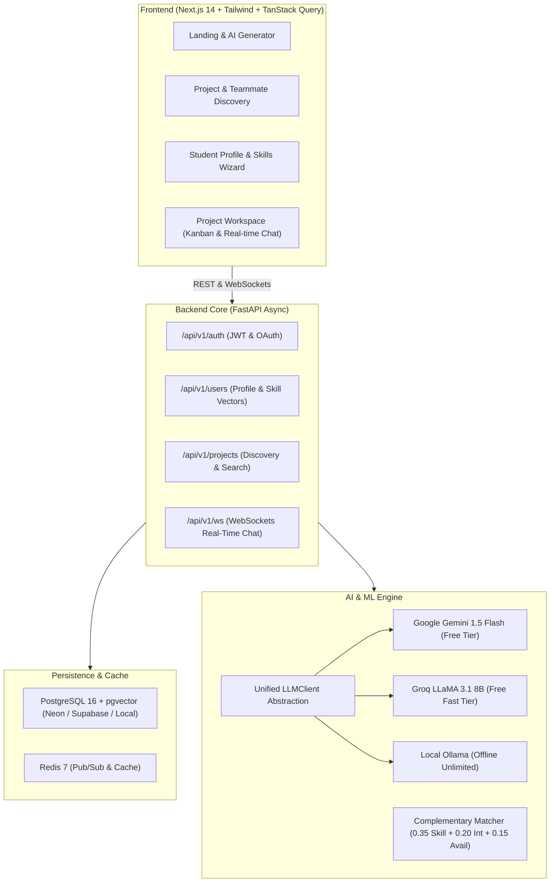

# CollabAI — AI-Native Student Project Collaboration Platform

[](LICENSE)
[](https://fastapi.tiangolo.com)
[](https://nextjs.org)
[](https://github.com/pgvector/pgvector)
[](https://ai.google.dev/)

> **Vision:** An intelligent collaboration platform where college and hackathon students discover teammates with complementary skills, plan milestones using structured AI outputs, collaborate in real-time, and leverage project-specific RAG throughout the entire development lifecycle.

---

## 🏗 Architecture & System Design



---

## 🚀 100% Free Tech Stack

| Layer | Tool | Why / Free Tier Details |
|---|---|---|
| **Frontend** | Next.js 14, TypeScript, Tailwind CSS, shadcn/ui, TanStack Query | Modern, reactive, fully open source |
| **Backend** | FastAPI, Pydantic v2, SQLAlchemy 2.0 (Async), Alembic | Ultra-fast async Python framework |
| **Database** | PostgreSQL 16 via **pgvector** (Local Docker, Neon, or Supabase) | Generous free cloud database tier + vector similarity |
| **Cache & Realtime** | Redis + FastAPI WebSockets | Real-time chat & pub/sub messaging |
| **AI / LLMs** | **Google Gemini Flash**, **Groq LLaMA 3.1**, and **Ollama** | Swappable behind one interface; zero vendor lock-in |
| **Vector Search** | **pgvector** (`vector_cosine_ops`) | Native in Postgres; zero extra infrastructure cost |
| **Synthetic Seeding** | `Faker` (50 fake students + 20 hackathon projects) | Instant bootstrap data for team matching |

---

## 📁 Monorepo Structure

```
collabai/
├── frontend/               # Next.js 14 App Router
│   ├── src/
│   │   ├── app/            # Routes (pages, layouts, globals.css)
│   │   │   ├── auth/       # Login, Register, Instant Demo
│   │   │   ├── profile/    # Onboarding & Skills wizard
│   │   │   ├── projects/   # Discovery, Detail, Create Project
│   │   ├── components/     # Navbar, Footer, UI components
│   │   └── lib/            # Type-safe API client & JWT manager
│   ├── tailwind.config.js
│   └── package.json
├── backend/                # FastAPI Application
│   ├── app/
│   │   ├── api/v1/         # Auth, Users, Skills, Projects routers
│   │   ├── core/           # Config, DB async engine, Security (PBKDF2/JWT)
│   │   ├── models/         # SQLAlchemy 2.0 models (User, Profile, Skill, Project)
│   │   ├── repositories/   # Data access repositories
│   │   ├── schemas/        # Pydantic validation schemas
│   │   └── services/       # Business logic
│   ├── scripts/
│   │   └── seed_data.py    # 50 students & 20 projects Faker seed script
│   ├── Dockerfile
│   └── requirements.txt
├── ai/                     # AI abstraction & prompt templates
│   ├── client.py           # Swappable LLMClient with retry logic
│   ├── adapters/           # Gemini, Groq, Ollama adapters
│   └── prompts/            # Pydantic structured output models (ProjectProposal)
├── docker/
│   └── init-pgvector.sql   # PostgreSQL vector extension initializer
├── docker-compose.yml      # Local Postgres (pgvector) + Redis + Backend
├── .env.example            # Environment variables template
└── README.md
```

---

## ⚡ Quick Start

### 1. Clone & Configure Environment

```bash
cd collabai
cp .env.example .env
cp .env.example backend/.env
```

### 2. Option A: Run with Docker Compose (Recommended)

```bash
docker compose up -d
```
This spins up:
- PostgreSQL with `pgvector` on port `5432`
- Redis on port `6379`
- FastAPI Backend on `http://localhost:8000`

### 3. Option B: Run Backend Locally with Python

```bash
cd backend
python3 -m venv venv
source venv/bin/activate
pip install -r requirements.txt

# Seed 50 students, skills taxonomy, and 20 projects:
python scripts/seed_data.py

# Start FastAPI server:
uvicorn app.main:app --reload --port 8000
```
API Documentation will be live at: **http://localhost:8000/api/v1/docs**

### 4. Run Frontend (Next.js)

```bash
cd ../frontend
npm install
npm run dev
```
Open **http://localhost:3000** in your browser.

---

## 🔑 Demo Credentials

A pre-seeded demo user account is provided for immediate testing:
- **Email:** `student@collabai.dev`
- **Password:** `password123`
- Or click **"Sign In as Demo Student"** on the login page for zero-typing authentication.

---

## 🤖 Swappable LLM Abstraction

When free quota on one provider runs out, simply update `.env` or call `switch_provider`:

```python
from ai import LLMClient
from ai.prompts.project_generator import ProjectProposal, format_project_generation_prompt

# Automatically picks provider from DEFAULT_LLM_PROVIDER ("gemini" | "groq" | "ollama")
client = LLMClient()

# Generate guaranteed Pydantic structured proposal:
proposal = await client.generate_structured(
    prompt=format_project_generation_prompt("Edge AI crop disease advisor"),
    schema=ProjectProposal
)
```

---

## 🗺 Development Roadmap

- [x] **Phase 1 (Weeks 1–2):** Authentication (JWT & OAuth), Student Profiles, Skills Taxonomy, Project Discovery, Monorepo Scaffolding, and Faker Seed Script.
- [x] **Phase 2 (Weeks 3–4):** Teams, Invitations, Kanban Board with `dnd-kit`, Real-Time WebSocket Chat with Redis pub/sub, Activity Feed.
- [x] **Phase 3 (Weeks 5–7):** AI Project Generator, Structured Milestone Planner, Task Decomposition, Assignee Recommendation, Streaming SSE.
- [x] **Phase 4 (Weeks 8–9):** Project-specific RAG with PyMuPDF chunking, `bge-small` embeddings in pgvector, Hybrid Search, and Citations.
- [x] **Phase 5 (Weeks 10–12):** Matching Algorithm v2 & XGBoost synthetic ranking, Deadline Risk predictor, NetworkX Skill Graph. See [ml/EVALUATION_REPORT.md](ml/EVALUATION_REPORT.md) for full metrics.
- [ ] **Phase 6 (Weeks 13–14):** GitHub App Integration, PR cycle time analytics, Prometheus + Grafana monitoring.
- [ ] **Phase 7 (Weeks 15–17):** Faster-Whisper Meeting-to-Tasks assistant, Project Knowledge Graph, Multi-Agent LangGraph Orchestrator.

